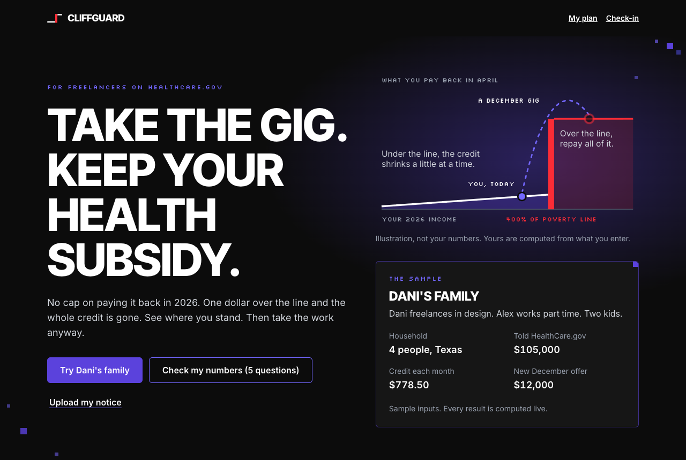
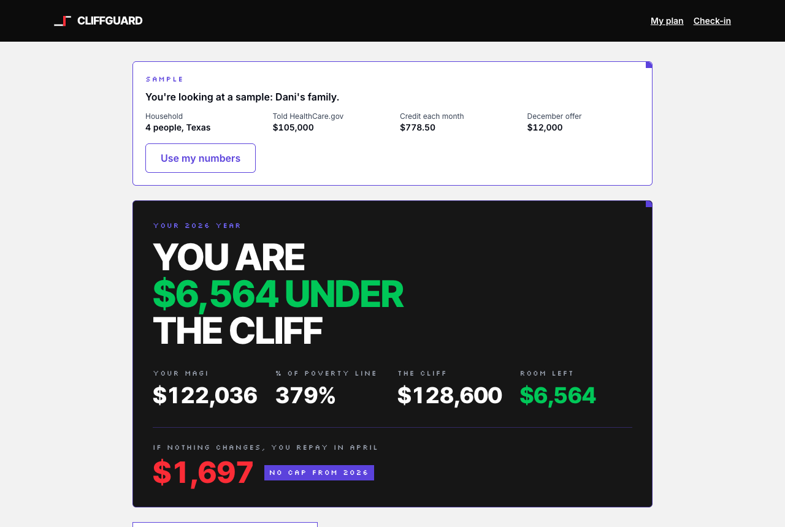
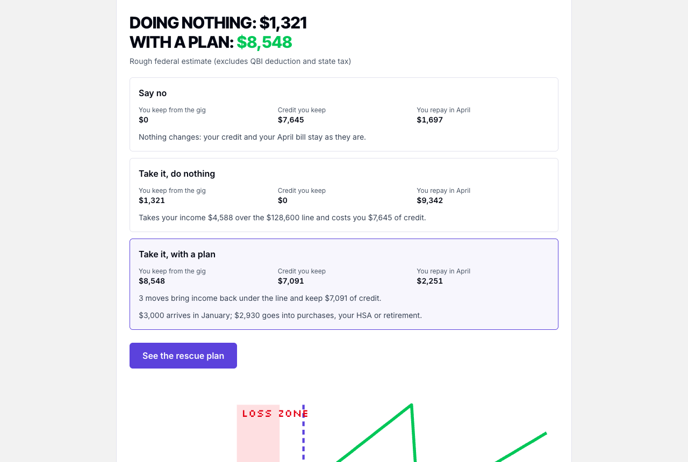
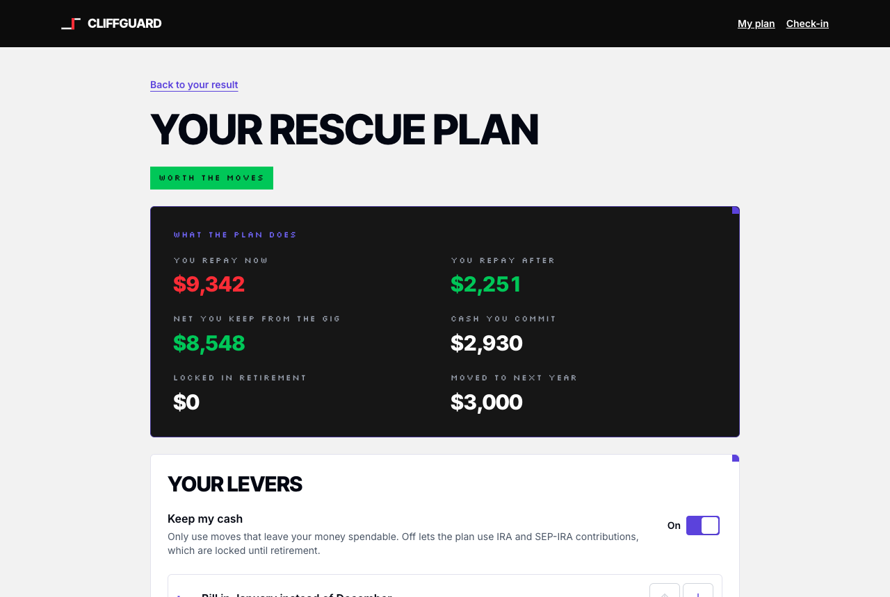
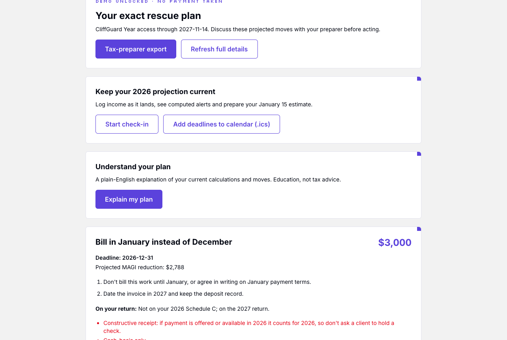
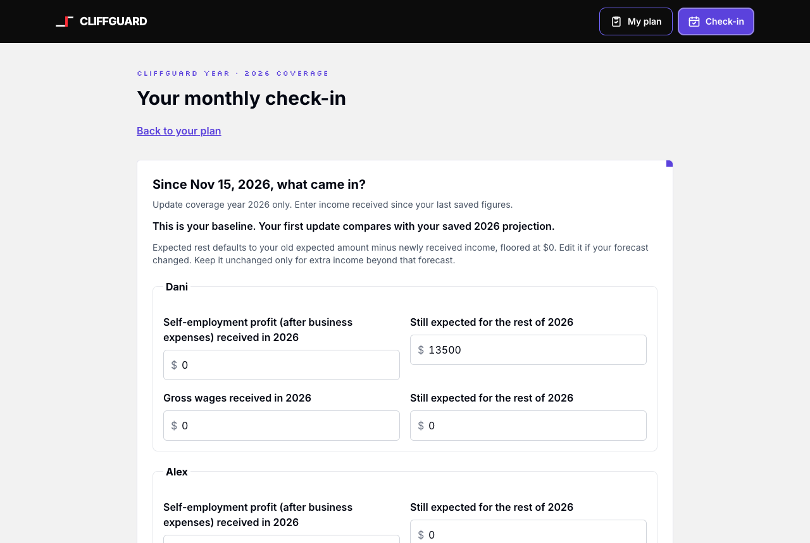
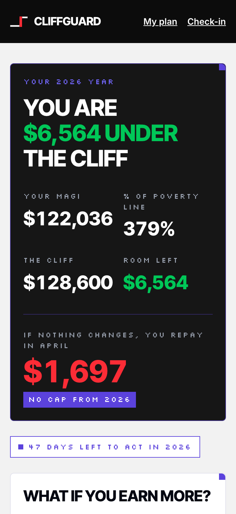
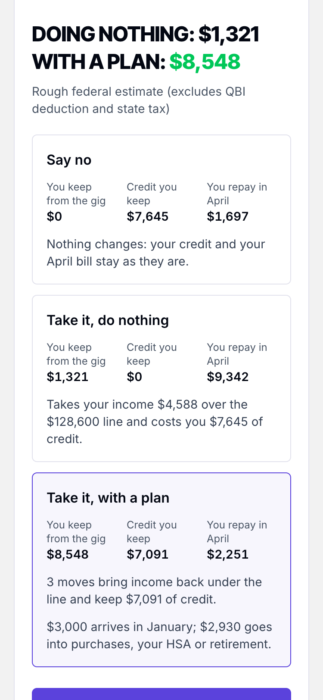

# CliffGuard

**Take the gig. Keep your health subsidy.**

CliffGuard is a web app for freelancers and other variable-income families on HealthCare.gov. Starting with tax year 2026 the ACA subsidy cliff is back (no income above 400% of the poverty line) and excess advance premium tax credit must be repaid in full. CliffGuard shows whether extra work this year pushes you over that line. It then builds a ranked, dated plan of legal moves that lets you take the work and keep the subsidy.

- **Live app:** https://cliffguard-beta.vercel.app
- **Repo:** https://github.com/batyrkhanz015/cliffguard
- **Education, not tax advice.**
- **Stack:** Next.js 16 (App Router), TypeScript strict, Tailwind 4, Zod, Upstash Redis, deployed on Vercel. AI: OpenAI GPT-6.1, server-side only, with Anthropic as an alternative provider.
- **Quality:** 584 automated tests (the engine reproduces published IRS, KFF and Morkel examples). Lint and strict typecheck are clean. The jury path was QA'd on production at desktop width and 375 px.



## Try it in 60 seconds

1. Open the app (no sign-up, no login).
2. Click **Check my numbers**, then **Try Dani's family** (one-click sample) at the top of the form.
3. Read the **result**: MAGI, the cliff, repayment owed, headroom.
4. Open the **gig check**: Dani's $12,000 December project, with and without a plan.
5. Open the **plan**: moves are previewed, exact amounts and how-tos are locked.
6. Click **Unlock Year demo — free**: no card, no charge (see "What is and is not live" below).
7. Click **Explain my plan** for a plain-English AI explanation. Every number in it is checked against the engine.
8. **Export** for a tax preparer, or open **check-in** to re-project with new income.

## The problem and the persona

**Dani Reyes, 37, freelance UX designer in Austin, TX.** Married, two kids, household of 4, bronze plan on HealthCare.gov. She estimated $105,000 for 2026, so the Marketplace pays her insurer advance credits. Her real year is lumpy and is heading to about $122k, against a cliff of $128,600 for a family of 4.

**Trigger moment (mid-November):** a client offers a $12,000 December project. She does not know what it would cost her in lost subsidy, and the moves that could help expire on December 31.

What she does today: guesses, runs a free calculator that prints a bill but no decision, asks a chatbot that may apply the old capped rules, or asks a CPA in March when it is too late. Free calculators stop at the bill; CliffGuard answers "should I take this gig, and what do I do about it?"

Evidence we reproduce exactly:
- IRS: repayment caps are eliminated for tax year 2026.
- KFF's family of 3 at 407% of the poverty line: $745 owed under the old rules, $34,463 without them.
- Morkel Financial's single filer at 403%: $7,294 repaid vs $3,289.

Not for: steady salaried households far under the line, people far over it (they get a "set this aside" verdict), or anyone with an employer health plan.

## What the engine computes (live, never hardcoded)

For the Dani sample, the engine computes these on every request:

| Output | Value |
|---|---|
| MAGI (net of half of self-employment tax) | $122,036 |
| Repayment if nothing changes | $1,697 |
| $12k gig, doing nothing | keeps $1,321 (repayment $9,342) |
| $12k gig, with the plan | keeps $8,548 |
| $8k gig, doing nothing | net -$1,668 (the "loss zone") |

These are fixtures in `src/engine/__tests__`; the unit tests assert them, and the app recomputes them from the household inputs rather than reading them from a table.

## What we sell

| | Free | Rescue, $59 one-time | Year, $79/yr |
|---|---|---|---|
| Where you stand, gig check, notice upload | yes | yes | yes |
| Exact amounts, how-to, deadlines, proofs, preparer export | | yes | yes |
| "Explain my plan" | | yes | yes |
| Monthly check-ins, alerts, calendar, 2027 estimate | | | yes |

People return because income lands monthly and the year has hard deadlines: Dec 31 moves, a monthly check-in that re-projects from real entries, Jan 15 (2027 estimate), Apr 15.

## Why it makes money

- **Honest wedge:** about 2.0–2.9M variable-income Marketplace households. At $79 that is a ceiling of roughly $12–17M ARR from the ACA cliff alone.
- **Path to ~$100M ARR (2030 hypothesis):** the same income-cliff engine covers other cliffs that bite at $60–160k household income, such as ACA cost-sharing tiers, income-driven student loans, IRA phase-outs and childcare credits. The second leg is B2B2C seats for CPAs, brokers and freelance platforms.
- **Unit economics (assumptions, not yet measured):**
  - blended CAC about $35, from SEO on engine-generated pages, freelancer creators and CPA partners;
  - first-year ARPU about $72;
  - gross margin about 90%;
  - LTV about $137, so LTV/CAC is about 3.9×;
  - payback on day one, because billing is annual and upfront.







 

## What is and is not live

- **Live:** the rules engine, gig check, optimizer, plan, notice upload and extraction, "Explain my plan", check-ins with history and alerts, `.ics` calendar, tax-preparer export, anonymous sessions, rate limits.
- **Demo unlock instead of Stripe:** real Stripe checkout is deferred. The unlock buttons show the prices but collect no card and charge nothing. They only work when `DEMO_UNLOCK_ENABLED=true`, and enabling it gives every visitor with a saved household access.
- **Cut:** free-form Q&A ("ask a what-if").
- **AI is live in production** on OpenAI GPT-6.1, for notice reading and "Explain my plan". Anthropic is supported as an alternative. Without a provider key, as in a local run with no env, the app falls back to manual entry and a labelled, calculation-based explanation.

## Architecture

```
 Browser (Next.js App Router, Tailwind)
   |  pure, client-safe engine: src/engine/index.ts
   |  (where you stand, gig check, charts)
   v
 Route handlers  src/app/api/*  (Zod on every input; AI output validated against schemas)
   |  session cookie (anonymous, httpOnly) -> store (Upstash Redis | in-memory)
   |  rate limits, redaction, entitlement checks      src/server/*
   |
   +--> Engine, server-only: src/engine/server.ts
   |      optimizer, lever copy, tax estimate; plan amounts never reach the browser unless unlocked
   |
   +--> OpenAI or Anthropic, server-only: src/server/ai/*
          reads an uploaded eligibility notice -> structured fields (user confirms them)
          explains the engine's finished numbers in prose (output validated against them)
```

- **Engine (deterministic, no I/O).** Every number comes from here: FPL tables, Form 8962 applicable figure, premium tax credit, repayment, gig check, an ordered legal optimizer ("Keep my cash" puts liquid moves first), deadlines, alerts, 2027 estimate.
- **Server.** Anonymous session id in an httpOnly cookie, a small store, per-session and per-IP limits, redaction of paid plan details for unpaid sessions, `.ics` generation, check-in logic.
- **AI's roles are narrow.** It reads documents and explains results. It never computes money. Uploaded text is treated as untrusted, outputs are validated with Zod, and numbers in explanations are checked against the engine.

Layout: `src/engine` (rules in `src/engine/rules`), `src/server`, `src/app/api`, `src/components`, `src/lib`, `src/samples`.

## Privacy, safety and abuse controls

- **No accounts.** Each visitor gets an anonymous random session id in an httpOnly, SameSite=Lax cookie, set `secure` in production. **Delete my data** erases the household, its check-ins and any cached explanation.
- **Uploaded notices are read in memory and never stored.** Only values the user reviews and confirms enter the form.
- **Paid plan details are redacted on the server for unpaid sessions,** so the browser never receives exact amounts or how-tos before unlock.
- **Abuse limits:**
  - per-session and per-IP rate limits on writes and AI routes;
  - a shared daily AI call cap;
  - a 4 MB upload cap with file-type checks;
  - an origin check on the unlock and check-in routes;
  - store outages return a clean 503 instead of crashing.
- **AI guardrails:**
  - documents are treated as untrusted data (prompt-injection aware);
  - outputs are structured and validated with Zod;
  - extraction keeps a field only with a verbatim quote from the document;
  - a grounding validator rejects any explanation number that doesn't match the engine, and the app then shows the calculation-based template instead.

## Fixture provenance

The engine is tested against published or primary-source cases (`src/engine/__tests__`):
- **KFF** family-of-3 example (2025 plan year, reproduced with a test-only 2025 rule set in `src/engine/rules/ty2025-enhanced.ts`).
- **Morkel Financial** single-filer examples ($3,512 and $7,294 under 2026 rules; $3,289 under the 2025 enhanced table).
- **IRS 2026 draft Form 8962** instructions: poverty-percentage truncation, the 401 rule above 4x the poverty line, and the applicable-figure table.
- Dani's household is a constructed persona, with outputs computed by the engine.

### Rules as of Nov 2026

The tables encode 2026 rules: no repayment cap, the 400% cliff, and bronze/catastrophic plans eligible for HSAs. Tax law is moving; every table value is in `src/engine/rules/ty2026.ts`, with its official source in `docs/tax-tables-2026.md`. Out-of-scope situations (for example married filing separately) are flagged in the UI instead of guessed.

## Run it locally

Use Node.js 22 or later (required by AI SDK 7).

```sh
npm i
npm run dev        # http://localhost:3000
npm test           # 584 tests
npm run lint && npm run typecheck
```

It runs with **no environment variables**: state is kept in memory and "Explain my plan" uses a calculation-based template explanation. Notice values can be entered manually; **Use Dani's numbers** loads a fictional family without an AI call.

To go further, copy `.env.example` to `.env.local`:
- Set `AI_PROVIDER=openai` and `OPENAI_API_KEY` for OpenAI. `OPENAI_MODEL` defaults to `gpt-6.1-sol`; `AI_PROVIDER=anthropic` with `ANTHROPIC_API_KEY` keeps Claude available as an alternative. Requests go directly to the selected provider; no AI Gateway account is required.
- `AI_ENABLED=false` forces manual/template fallbacks. `AI_DAILY_CALL_CAP=100` caps provider calls across all visitors, including failures and the one allowed grounding retry. The shared counter survives provider changes. Existing Anthropic installations without the new settings retain `CLAUDE_ENABLED` and `CLAUDE_DAILY_CALL_CAP` compatibility.
- Both providers cap output at 4,000 tokens/call. Existing per-session/IP limits, 4 MB uploads, timeouts and explanation caching remain. A request cap is not a dollar budget; input-token/page limits and an application-enforced spending budget are still future work. Configure a project spend limit separately with the provider.
- OpenAI requests use strict structured output, low reasoning effort, `store: false`, no tools, no automatic transport retries and no content telemetry. This disables Responses storage; it does not promise zero retention under the provider's other policies.
- `DEMO_UNLOCK_ENABLED=true` turns on the no-payment demo unlock (off by default, even in development).
- Production also needs `UPSTASH_REDIS_REST_URL` and `UPSTASH_REDIS_REST_TOKEN`, and `DEMO_UNLOCK_ENABLED=true` for the jury path.

Secrets live only in environment variables; `.env*` files are git-ignored.
